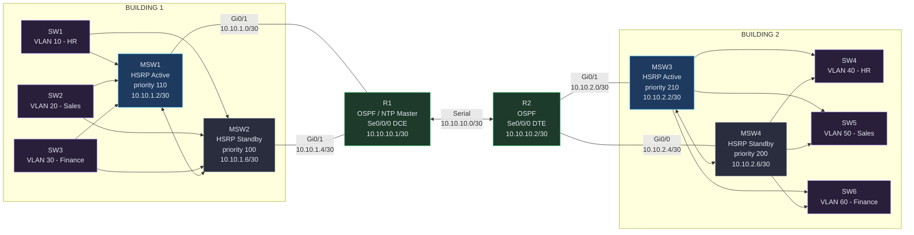

# README

# Enterprise Network Lab — Cisco Packet Tracer

Mục tiêu: Xây dựng hệ thống mạng dành cho doanh nghiệp với 2 tòa nhà giả định
Công nghệ sử dụng: DHCP,OSPF,Routing Inter-VLAN,HSRP, NTP.
Tóm tắt: Thiết kế hệ thống có dự phòng đầy đủ, định tuyến động liên tòa nhà, cấp IP tự động không mất phiên khi failover.

---

## Topology tổng quan



---

## Thiết bị

| Thiết bị | Vai trò | Ghi chú |
| --- | --- | --- |
| R1 | Router trung tâm B1, NTP master | DCE, clock rate 64000 |
| R2 | Router trung tâm B2 | DTE |
| MSW1 | Distribution B1, HSRP Active | priority 110, DHCP .11–.127 |
| MSW2 | Distribution B1, HSRP Standby | priority 100, DHCP .128–.254 |
| MSW3 | Distribution B2, HSRP Active | priority 210, DHCP .11–.127 |
| MSW4 | Distribution B2, HSRP Standby | priority 200, DHCP .128–.254 |
| SW1–SW3 | Access layer B1 | VLAN 10/20/30 |
| SW4–SW6 | Access layer B2 | VLAN 40/50/60 |

---

## Tính năng đã cấu hình

| Tính năng | Chi tiết |
| --- | --- |
| VLAN | 10/20/30 (B1 — HR/Sales/Finance), 40/50/60 (B2 — HR/Sales/Finance) |
| 802.1Q Trunk | Tất cả link switch–switch và switch–MSW |
| Inter-VLAN routing | SVI trên MSW + `ip routing` |
| HSRP | Dự phòng gateway, preempt bật trên cả 2 switch |
| OSPF Area 0 | Single area, passive interface trên SVI |
| WAN Serial | R1 (DCE) ↔︎ R2 (DTE), 64 Kbps |
| DHCP | Split-pool: primary .11–.127, standby .128–.254 |
| NTP | R1 làm master stratum 1, tất cả thiết bị sync về R1 |

---

## Cơ chế dự phòng

**HSRP** — Dự phòng gateway:

- MSW1/MSW3 là Active (priority cao hơn).
- MSW2/MSW4 là Standby, giám sát qua Hello packet mỗi 3 giây.
- Khi Active hỏng: Standby tự lên Active trong vòng 10 giây.
- Khi Active phục hồi: `preempt` giúp giành lại vai trò tự động.

**DHCP split-pool** — Dự phòng cấp IP:

- Cả hai switch đều chạy DHCP cùng lúc với dải không trùng nhau.
- Khi switch chính hỏng: switch dự phòng vẫn cấp IP bình thường từ dải của nó.
- Không có IP conflict, không mất DHCP khi failover.

**OSPF** — Định tuyến động:

- Tự động cập nhật bảng định tuyến khi topo thay đổi.
- Passive interface trên SVI: quảng bá subnet nhưng không gửi Hello xuống host.

---

## Cấu trúc thư mục

```
enterprise-network-lab/
├── README.md                        ← file này
├── packet-tracer/
│   └── INDIVIDUAL_LAB.pkt
├── configs/
│   ├── routers/
│   │   ├── R1.txt
│   │   └── R2.txt
│   ├── building1/
│   │   ├── access-switches/
│   │   │   ├── SW1.txt
│   │   │   ├── SW2.txt
│   │   │   └── SW3.txt
│   │   └── multilayer-switches/
│   │       ├── MSW1.txt
│   │       └── MSW2.txt
│   └── building2/
│       ├── access-switches/
│       │   ├── SW4.txt
│       │   ├── SW5.txt
│       │   └── SW6.txt
│       └── multilayer-switches/
│           ├── MSW3.txt
│           └── MSW4.txt
└── docs/
    ├── dia-chi-ip.md                ← topology chi tiết + bảng địa chỉ IP đầy đủ
    ├── hsrp.md                      ← cơ chế HSRP, cấu hình, kịch bản failover
    ├── ospf.md                      ← cơ chế OSPF, network statements, passive interface
    └── dhcp.md                      ← split-pool DHCP, lý do thiết kế, cách test
```

---

## Lệnh xác minh nhanh

```bash
# OSPF
show ip ospf neighbor          ! phải thấy 3 láng giềng FULL trên R1
show ip route ospf             ! kiểm tra route cross-building

# HSRP
show standby brief             ! trạng thái Active/Standby từng VLAN

# DHCP
show ip dhcp binding           ! danh sách IP đã cấp
show ip dhcp pool              ! dải địa chỉ, số lượng đã dùng

# Kết nối
ping 192.168.40.1 source vlan10   ! B1 VLAN10 → B2 VLAN40 gateway
```
